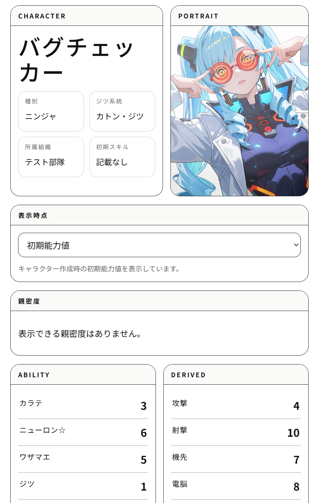
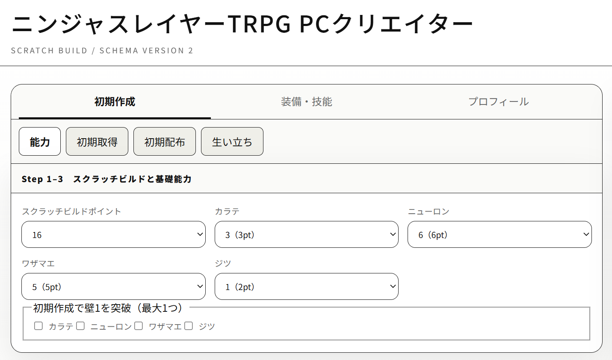
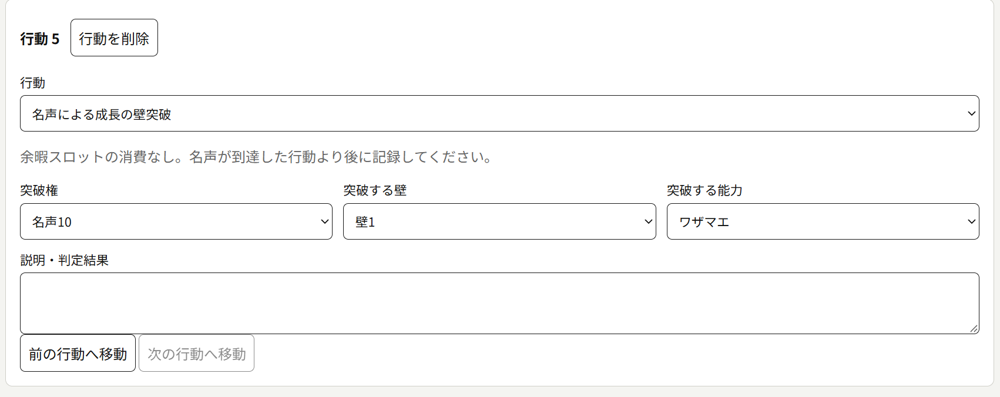
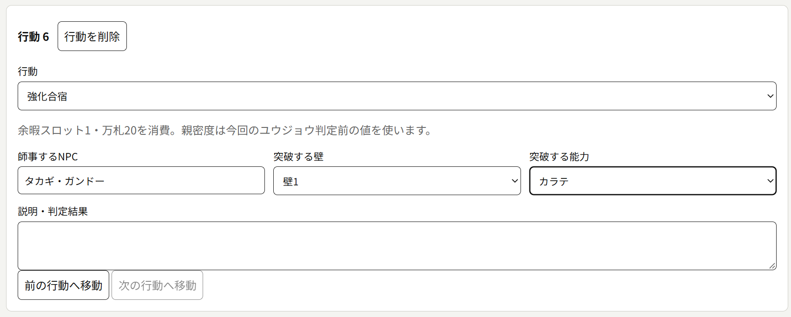
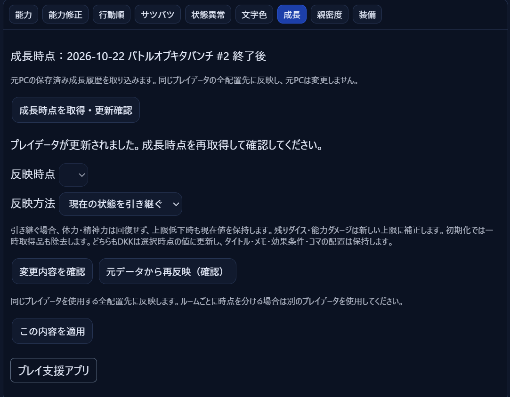

# 「成長の壁」機能について
ニンジャの基礎能力値には「成長の壁」と「成長限界40」という2つの制限が存在する。
ここでは、「成長の壁」と、それを設定する機能と反映する方法について説明する。

## 「成長の壁」について

「成長の壁」とは、それ以上、能力値を上げられないことを意味します。
「成長の壁」は、「成長の壁1」と「成長の壁2」とがあります。
カラテの「成長の壁1」は6と7の間、カラテの「成長の壁2」は12と13の間にあります。
ニューロンの「成長の壁1」は6と7の間、ニューロンの「成長の壁2」は12と13の間にあります。
ワザマエの「成長の壁1」は6と7の間、ワザマエの「成長の壁2」は12と13の間にあります。
ジツの「成長の壁1」は3と4の間、ジツの「成長の壁2」は6と7の間にあります。

整理すると以下のようになります。

| 能力値 | 成長の壁1 | 成長の壁2 |
|---|---|---|
| カラテ | 6と7の間 | 12と13の間 |
| ニューロン | 6と7の間 | 12と13の間 |
| ワザマエ | 6と7の間 | 12と13の間 |
| ジツ | 3と4の間 | 6と7の間 |

L-VTTとその関連機能では、「成長の壁」を「☆」印で表現します。
カラテの例で説明すると、以下のようになります。

カラテの「成長の壁1」を突破していたら能力値の名前を「カラテ☆」、
カラテの「成長の壁2」を突破していたら能力値の名前を「カラテ☆☆」になります。
整理すると、以下の表示例のようになります。

表示例：

|突破状態|表示|
| --- | --- |
|未突破|カラテ|
|成長の壁1を突破|カラテ☆|
|成長の壁2まで突破|カラテ☆☆|

あるいは、ニューロンの「成長の壁」を一段階突破してある場合、以下の表示なります。

## 「成長限界40」について
ニンジャの基礎能力値は、合計の最大値が40以下で無ければならない。
また各能力値にも最大値が存在する。

|基礎能力値|最大値|
| --- | --- |
|カラテ|18|
|ニューロン|18|
|ワザマエ|18|
|ジツ|9|

## 「成長の壁」を記録する機能について

「成長の壁」を突破するルールには4つがあります。
L-VTTとその関連機能では以下の3機能について実装しています。

- 高ポイントのスクラッチビルド時の初期
- 「名声」の上昇
- 「強化合宿」の実施

### 高ポイントのスクラッチビルド時の初期における「成長の壁」の突破

- 16ポイントスクラッチビルドでは、任意の1つの能力値の「成長の壁1」を突破できます。
- 28ポイントスクラッチビルドでは、任意の2つの能力値の「成長の壁1」を突破できます。

具体的には、PCクリエイターの以下の機能をにより実現します。

ニンジャスレイヤーTRPG PCクリエイターの
「初期作成」タブの「能力」タブに存在する
「初期作成で壁1を突破」のラジオボタンで突破する基礎能力値を選択します。

### 「名声」の上昇による「成長の壁」の突破

- 成長によって名声が初めて5に到達したとき、任意の1つの能力値の「成長の壁1」を突破できます。
- 成長によって名声が初めて10に到達したとき、任意の1つの能力値の「成長の壁1」を突破できます。
- 成長によって名声が初めて15に到達したとき、任意の1つの能力値の「成長の壁2」、あるいは、任意の2つの能力値の「成長の壁1」を突破できます。
- 成長によって名声が初めて20に到達したとき、任意の1つの能力値の「成長の壁2」、あるいは、任意の2つの能力値の「成長の壁1」を突破できます。

具体的には、
ニンジャスレイヤーTRPG
レベルアップ支援の以下の機能をにより実現します。

行動で、「名声による成長の壁突破」を選択します。
突破権は名声が何点に到達したときの突破かを選択します。
突破する壁は、壁1か壁2を選択します。
突破する能力を選択します。

なお、16ポイントスクラッチビルドでは名声が5に到達したときの分は、初期作成で使ったものとみなし、10に到達して時の分からしか選べません。

同様に、28ポイントスクラッチビルドでは、名声が5と10に到達したときの分は、初期作成で使ったものとみなし、15に到達して時の分からしか選べません。

### 「強化合宿」の実施による「成長の壁」の突破

- 名声が5以上あり、余暇スロットの「強化合宿」で万札20を消費し、親密度が2以上のNPCに師事した場合、任意の1つの能力値の「成長の壁1」を突破できます。
- 名声が5以上あり、余暇スロットの「強化合宿」で万札20を消費し、親密度が3以上のNPCに師事した場合、任意の1つの能力値の「成長の壁2」を突破できます。

具体的には、
ニンジャスレイヤーTRPG
レベルアップ支援の以下の機能をにより実現します。

行動で、「強化合宿」を選択します。
師事するNPCを選択します。
突破する壁は、壁1か壁2を選択します。
突破する能力を選択します。

## 反映方法

### レベルアップ支援 分だけの反映

1. L-VTT で 対象キャラクターの状態ウィンドウを表示する。
2. 「成長」タブを選択する。
3. 「成長時点を取得・更新を確認」ボタンを押下する。
4. 「**反映内容を確認**」ボタンを押下する。
5. 反映の前後の能力などが表示される
6. 「この内容を適用」ボタンを押下する。

### PCクリエイターで変更した分も反映

1. L-VTT で 対象キャラクターの状態ウィンドウを表示する。
2. 「成長」タブを選択する。
3. 「成長時点を取得・更新を確認」ボタンを押下する。
4. 「**反元データから再反映（確認）**」ボタンを押下する。
5. 反映の前後の能力などが表示される
6. 「この内容を適用」ボタンを押下する。