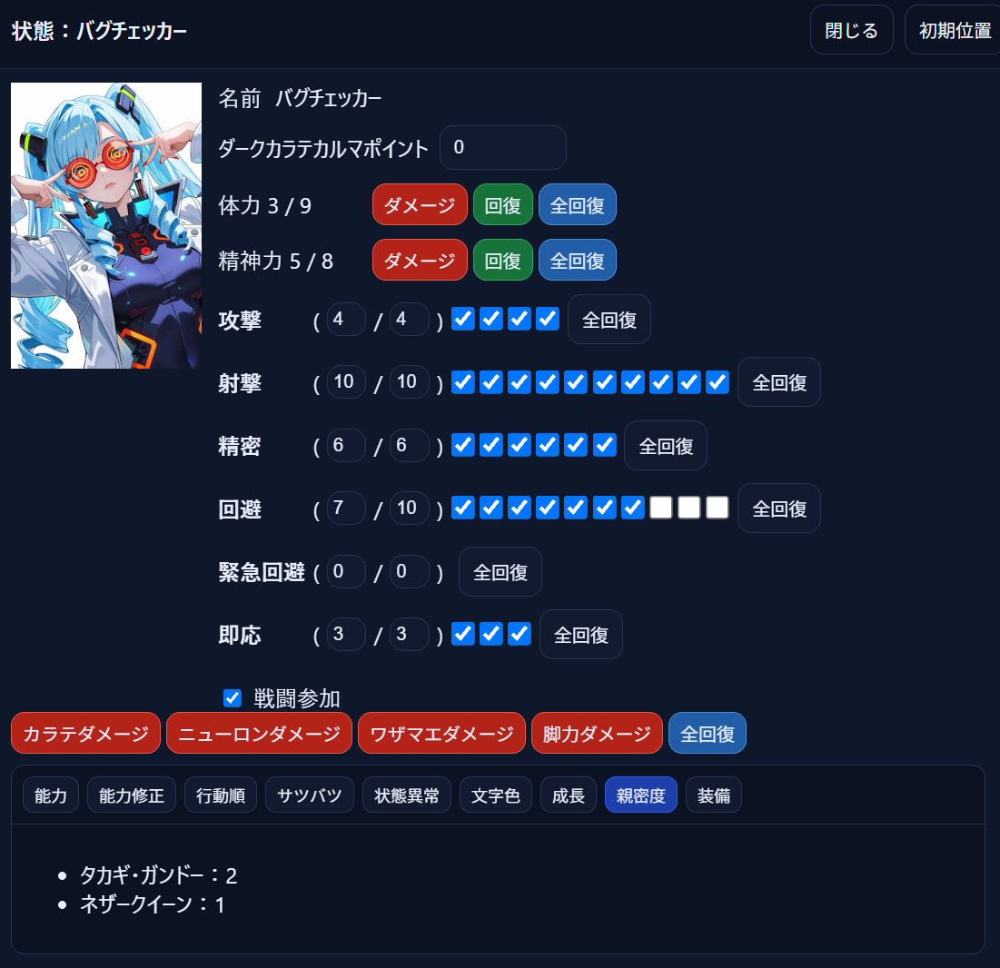
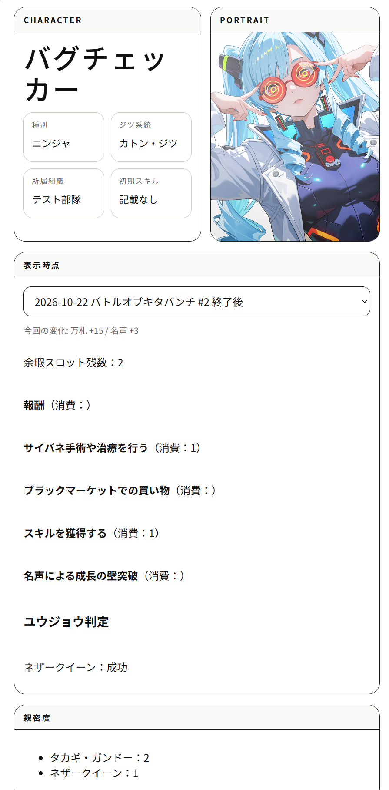
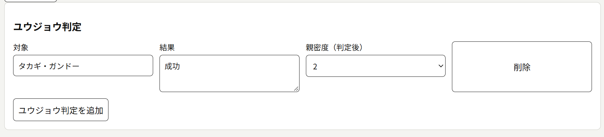

## ユウジョウ判定の結果の表示

ユウジョウ判定の結果、取得可能な親密度について、L-VTTと
忍殺TRPG PCビューワーで参照可能にしました。

しかし、この表示をするためには、
忍殺TRPG レベルアップ支援のユウジョウ判定に少し情報を追加して更新する必要があります。

## レベルアップ支援のユウジョウ判定へのデータ追加

忍殺TRPG レベルアップ支援のユウジョウ判定に「親密度（判定後）」が加わっています。
対象の名前を同じにすれば親密度の向上が表現できます。
判定に失敗した場合は「親密度（判定後）」を「未入力（引き継ぐ）」にすると良いです。

## L-VTTでの反映方法

1. L-VTT で 対象キャラクターの状態ウィンドウを表示する。
2. 「成長」タブを選択する。
3. 「成長時点を取得・更新を確認」ボタンを押下する。
4. 「**反映内容を確認**」ボタンを押下する。
5. 反映の前後の能力などが表示される
6. 「この内容を適用」ボタンを押下する。