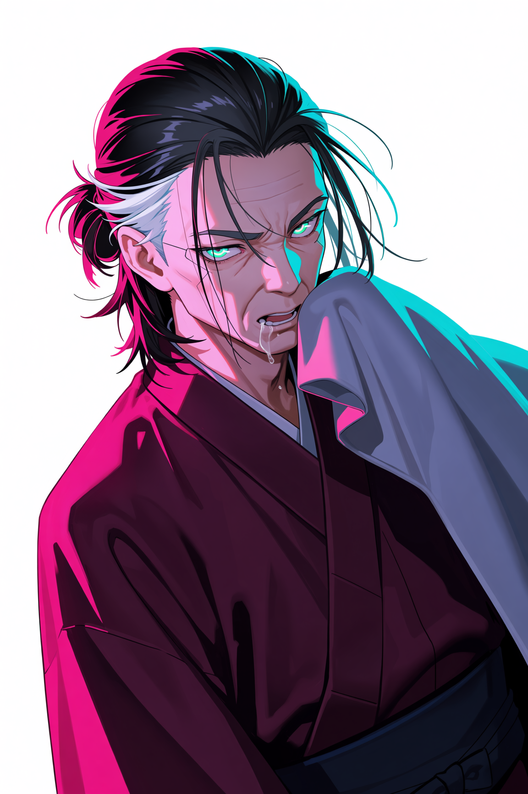
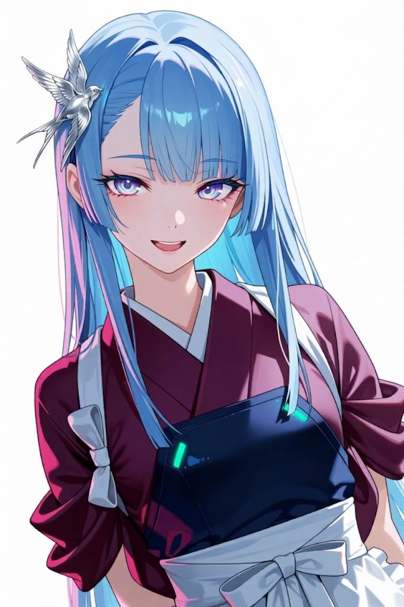
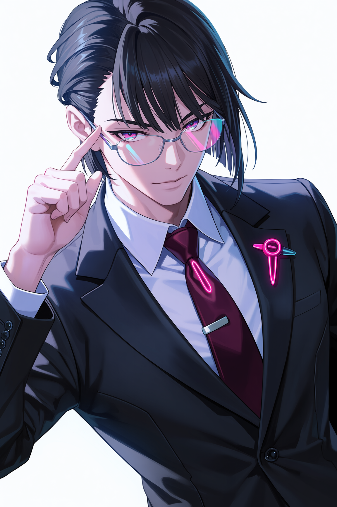
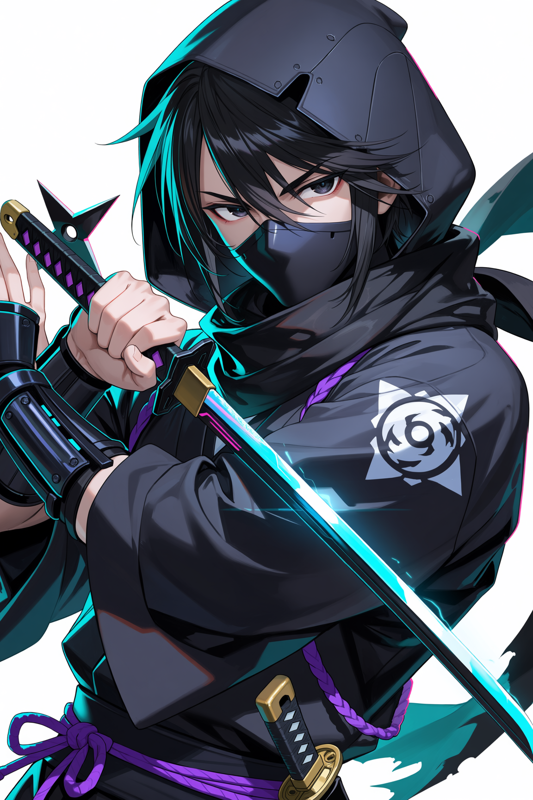
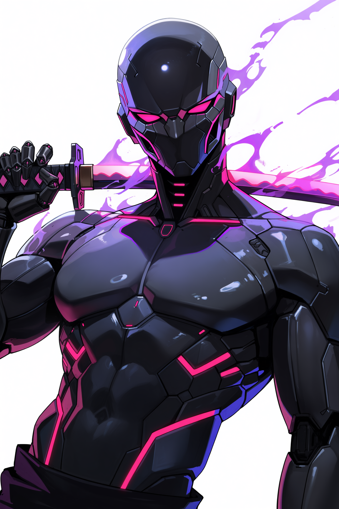
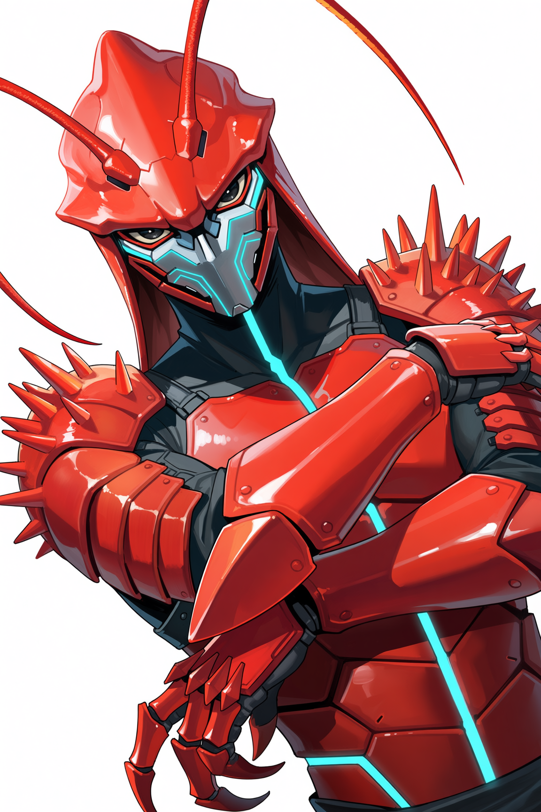
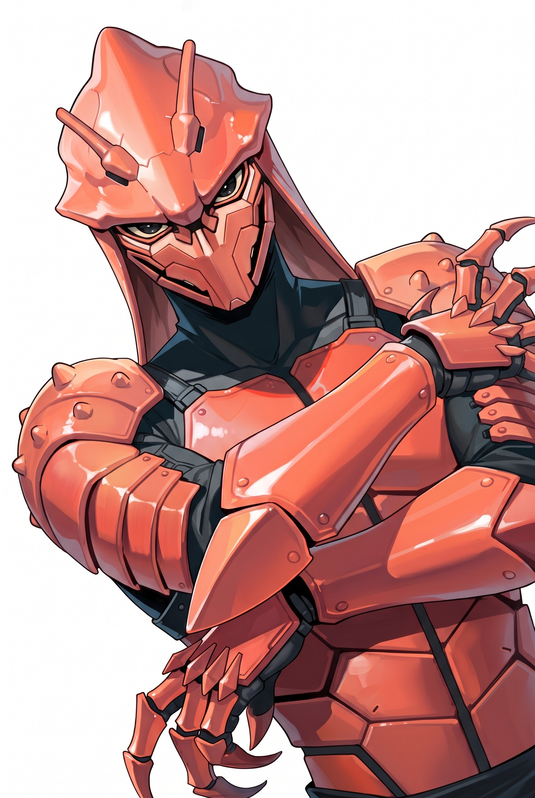

# 2026-10-15: キャンペイグンの背景設定

設定、イラストは調整中のものです。本編開始までに変更される可能性があります。

## ■背景
- 舞台: ネオサイタマ、ネオカブキチョ ニチョーム・ストリート近くのキタ・バンチ
- 所属: ツバメ・ハイタツ

## ■設定

### ●ツバメ・ハイタツ
- ツバメ・ヤクザクラン「極燕組」(廃業状態)を支えるために、ソウエン＝サンが立ち上げたニンジャビリティを駆使し、いままでのハイタツヤでは届けられなかった場所へ、届けられなかったものを届ける、半ば便利屋めいた集団である。

### ●ゴクエングミ・クラン
- ツバメ・ヤクザクラン「極燕組」であり、組長が体調を崩しているため組員のほとんどが出奔し、廃業状態ある。
- ニチョーム・ストリート近くのキタ・バンチをナワバリにしていたが、「グランアップ・コーポ」による区画整理のための立ち退き圧力に頭を痛めている。

### ●グランアップ・コーポ
- 表向きは正規の建設会社であるが、その実はザイバツのシタウケであり、ニンジャの実行戦力部隊を持つ。
- 荒事を好まないが、どちらかというと儲け優先主義で、無理な保証金での立ち退きを要求するくらいのことは平気でやる程度には倫理観がネオサイタマレベルである。

## ■初期NPC

### ●エンショウジ・ショーゾー
- 極燕組の現組長。人情肌の任侠だったが、ハイケッカクの病を患っており、身体を自由に動かすことが出来なくなっている。

### ●エンショウジ・ツバメ
- ショーゾーの娘。年を取ってからの娘で、目に入れても痛くないほどショーゾーは可愛がっている。
- 勝ち気だが気立てが良く、誰にでも優しい、しかし、それは世間知らず故でもある。
- ジッサイ、ヒロイン。さらわれそうになるぞ。

### ●ウカイケ・ジンヤ
- いわゆるインテリヤクザ。
- ショーゾーの子飼いだったが、現在は離反して「ウミサキ・ケンセツ」を立ち上げ、部下もそちらに持ち去った。
- ショーゾーのやり方では、キタ・バンチを守れないと判断しての独立であり、ケジメをつけたため彼は左手の小指が無い。
- 考えすぎる嫌いがあるが有能なモータル。多分、高確率で死にます。

### ●ランドシェイカー
- 元ザイバツニンジャ。古典的ニンジャ。野心あふれるニンジャ。
- ニンジャとして高貴な血筋に生まれた、その野心に見合った地位をザイバツでは得られず、シタウケに出向した。
- 好きな台詞は「鶏口となるも牛後となるなかれ」

### ●アールタ
- フルボーグなサイバネニンジャ。人の心は無い。冷酷無比な殺戮マシーン。
- ある計画で量産されたサイバネニンジャの完成形であるらしい。
- フルボーグに理解が無いザイバツにおいて実戦経験を増やすため、「グランアップ・コーポ」に配属されている。
- 「問題ナイ。任務、遂行スル・・・」(合成音声)

### ●クローウオー
- ザリガニ怪人バイオニンジャ。残虐ファイト大好き。
- バイオニンジャの肩身が狭いザイバツを諦め、一発逆転を狙って「グランアップ・コーポ」に参加した。
- 部下は量産型コーザリー。
- 「ザーリザリザリ、暴力！、暴力は全てを解決する！！」

### ●コーザリー
- 量産型のザリガニ怪人バイオニンジャ。あまり個性はない。知性も無い。
- クローウオーに対する忠誠心は高い。
- 「コーザリー！！」

